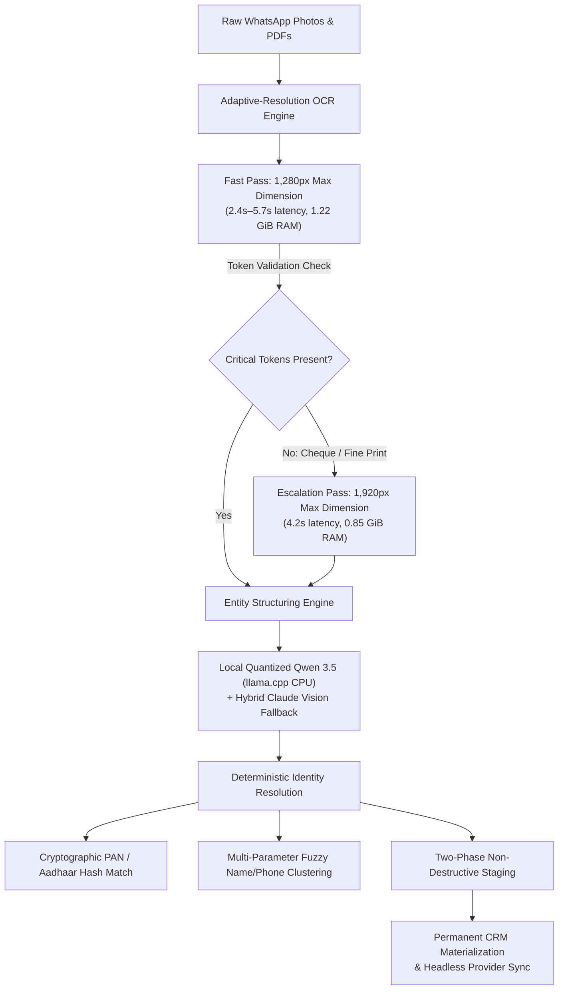

# InsureFlow AI — Multi-Modal Document Extraction & Identity Resolution

[](https://hardiksapra.com)
[](https://hardiksapra.com)
[](https://hardiksapra.com/work/insureflow-ai)
[](https://opensource.org/licenses/MIT)

A production-grade, low-memory pipeline for extracting structured entities from unstructured, mobile-captured WhatsApp documents (photos, scans, multi-page PDFs) and deterministically resolving customer identities without cloud API dependencies.

Built by **[Hardik Sapra](https://hardiksapra.com)** (Senior Software Engineer & AI Systems Consultant). Read the full live case study at [hardiksapra.com/work/insureflow-ai](https://hardiksapra.com/work/insureflow-ai).

---

## ⚡ The Production Problem

Most tutorials treat Document AI as a naive call to cloud LLMs (e.g. GPT-4o Vision). In production WhatsApp intake workflows, this fails because:
1. **Unconstrained Inputs**: Field agents submit angled, blurry, low-resolution phone photos alongside dense multi-page PDFs.
2. **Cloud Latency & Cost**: Pushing raw megabyte images to multimodal APIs introduces 10s–30s latency per page and unbounded token bills.
3. **Transient Session Pitfalls**: Tracking identity via conversational chat state breaks when users submit documents over multiple days or from different phones.
4. **Data Corruption**: Merging partial OCR reads directly into a production CRM overwrites verified client data.

---

## 🏗️ System Architecture



---

## 📊 Real-World Production Benchmarks

Evaluated on a resource-constrained production host (**1 vCPU Intel Xeon Sapphire Rapids, 3.8 GiB RAM**):

| Pass / Stage | Input Resolution | Peak RAM | Sample Latency | Token Recovery Rate |
| :--- | :--- | :--- | :--- | :--- |
| **PaddleOCR Mobile v5 (Standard)** | 1,280px max | 1.22 GiB | 2.4s – 5.7s / page | 33 / 34 critical tokens (97.1%) |
| **Adaptive Retry (Dense Cheque/Policy)** | 1,920px max | 0.85 GiB | 4.2s / page | 34 / 34 critical tokens (100%) |
| **Qwen 3.5 Structuring (CPU llama.cpp)** | Quantized GGUF | 1.10 GiB | 3.1s / doc | Structured Pydantic JSON |

### Operational Outcome
- **Routine Client Servicing**: Cut from **~45 minutes** to **<2 minutes** per document batch.
- **Cost**: ~$0 per standard document scan on existing CPU infrastructure.

---

## 🔑 Core Components

### 1. Adaptive Resolution Pipeline (`pipeline/adaptive_ocr.py`)
Rather than blindly running high-res OCR or heavy cloud models, the ingestion worker runs adaptive scaling:
1. Normalizes images to a 1,280px bounding box.
2. Validates extracted tokens against regex rules for high-entropy identifiers (Aadhaar, PAN, IFSC).
3. If a critical identifier is missing (e.g. tiny 10-digit account numbers on a bank cheque), the isolated process escalates to 1,920px for targeted recovery.

### 2. Deterministic Identity Resolution (`pipeline/identity_resolution.py`)
- Identity is computed **from document-level cryptographic signatures**, never transient WhatsApp sessions.
- Prevents cross-contamination when multiple agents submit documents for the same household.
- Fuzzy matching catches minor phonetic misspellings without hallucinating matches.

### 3. Two-Phase Staging Architecture
All incoming files stage in a quarantined directory (`uploads/intake_staging/`) with derived metadata. Permanent commitment to `clients` and `documents` only occurs upon positive verification, enabling atomic rollbacks and zero-residue undo.

---

## 🚀 Quickstart

```bash
# Clone the repository
git clone https://github.com/doctornuclear/insureflow-ai-ocr.git
cd insureflow-ai-ocr

# Install dependencies
pip install -r requirements.txt

# Run the pipeline test
python -m pipeline.adaptive_ocr
```

---

## 👤 Author & Consulting

**Hardik Sapra**  
Senior Software Engineer & AI Systems Consultant  
- **Website & Portfolio**: [hardiksapra.com](https://hardiksapra.com)
- **LinkedIn**: [linkedin.com/in/hardik-sapra](https://www.linkedin.com/in/hardik-sapra)
- **Book an Architecture Call**: [Google Calendar](https://calendar.app.google/sCgvsrMBvch5bnuU9)
- **Direct WhatsApp**: [+91 9313972744](https://wa.me/919313972744)
- **Email**: hardik.sapra1@gmail.com
